# CD的拾光猫

一个免费的 Mac 小工具：**截图标注 + 长截图 + 录屏 + 剪贴板 + 刘海灵动岛**，装上就能用。

适用于 Apple 芯片（M 系列）Mac，macOS 15 及以上。

## 下载

👉 [下载最新版](https://github.com/Dino12138/shiguangmao-releases/releases/latest)：点开后在 Assets 里下载 `ShiGuangMao-版本号.dmg`。

装好以后有新版本会自动提示，点「立即更新」即可：下载、校验、安装都有进度显示，完成后自动重启，不用再来这里下载。

---

## 刘海灵动岛

鼠标移到屏幕顶部的刘海上，自动展开。

**首页：正在播放 + 日历日程**

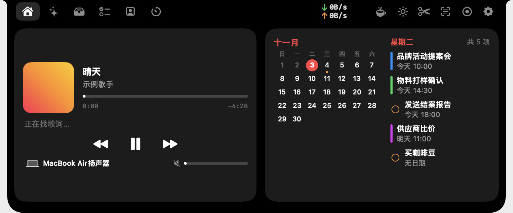

**暂存 + 隔空投送**：把文件拖进刘海暂存，用的时候再拖出来；拖到右边直接隔空投送。

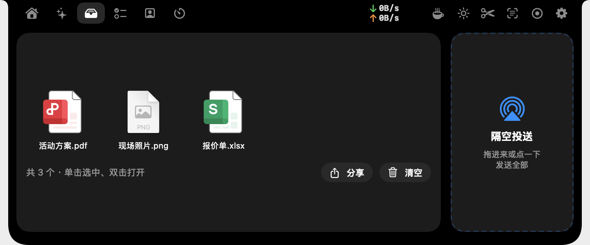

**提醒事项 + 备忘录**：直接新建提醒、浏览备忘录。

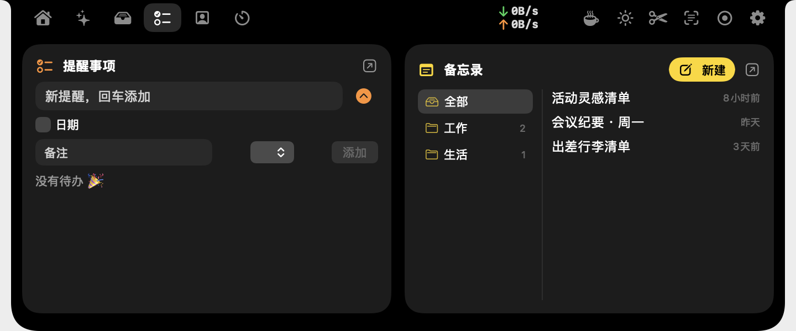

**番茄钟 / 倒计时**

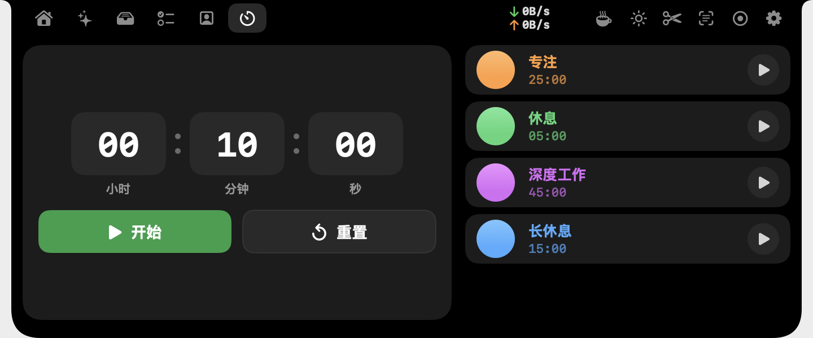

**AI 任务状态**：Claude Code / Codex 运行时，刘海里实时显示进度。

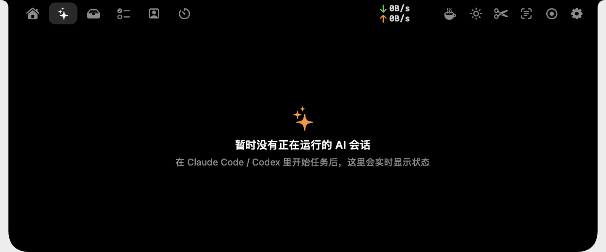

另有「镜子」（摄像头小窗）、实时网速、防休眠、一键截图 / 识字 / 录屏。

---

## 截图标注（⌃A）

截完直接在原地标注，工具条下方都写了名称和快捷键。

| 功能 | 演示 |
|---|---|
| **长截图（L）** 往下、往上滚都能拼接；一键自动滚动，随时停止 | 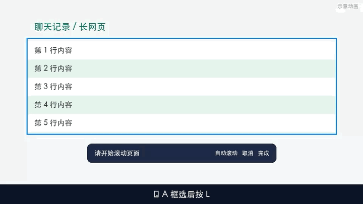 |
| **框线箭头（2）** 框 + 箭头一步画好，形状、颜色、粗细、长短都能调 | 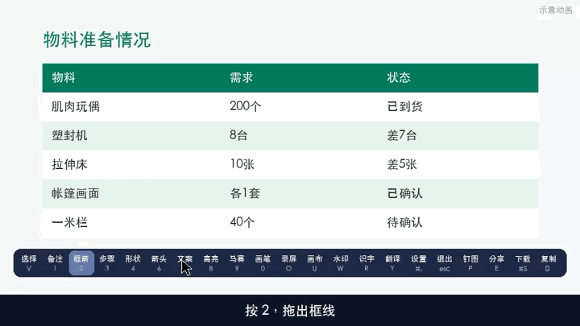 |
| **文字与备注（7 / 1）** 随时点进去修改，自动加宽 | 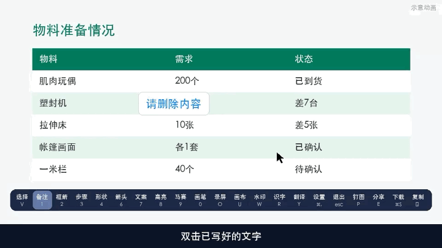 |
| **马赛克（9）** 密度、颜色可调，改了已画的也跟着变 | 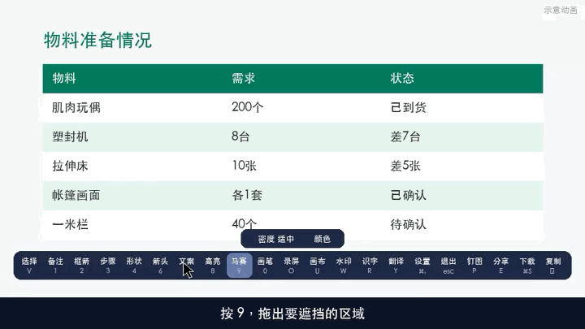 |
| **水印（W）** 文字、日期、大小、透明度可调，可存为默认 | 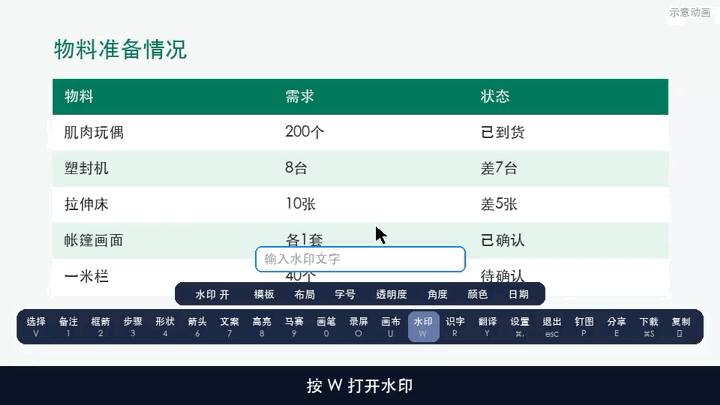 |
| **画布（U）** 给截图加背景和形状 | 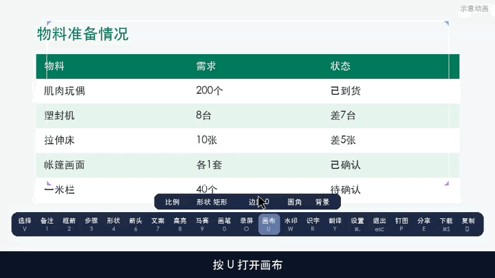 |
| **选择工具（V）** 画完的标注还能移动、调整 | 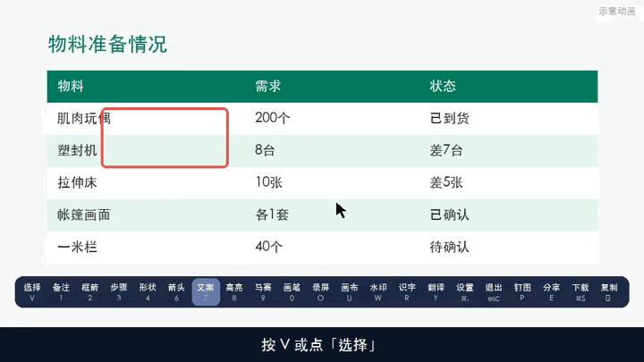 |
| **画完还能调** 选中已有标注，直接改颜色、大小 | 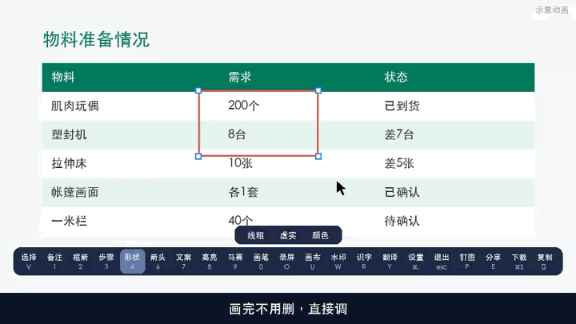 |
| **贴例图（⌃V）** 截图里直接粘贴参考图 | 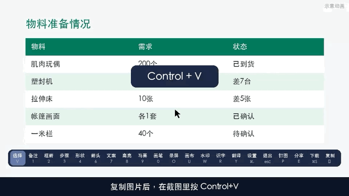 |
| **钉图（⌃P）** 钉在屏幕上的图也能被截进去 | 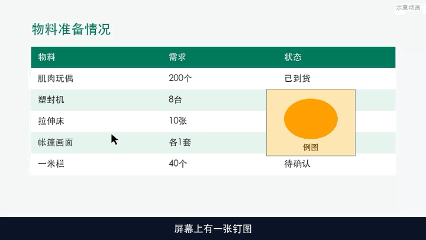 |
| **剪贴板（⌃X）** 历史记录，双击直接粘贴 | 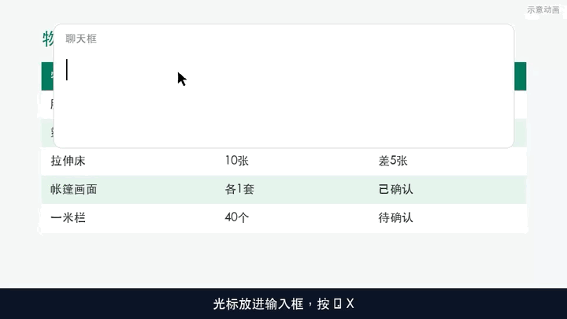 |

还有：截图识字（⌃⇧A）、翻译、录屏（⌃S）、高亮、步骤编号、画笔等。

## 意见反馈

菜单栏小猫 › 意见反馈，或 设置 › 关于 › 写反馈。遇到问题、想要什么新功能，直接写给我，会第一时间看到。

---

## 安装

1. 打开 dmg，把「CD的拾光猫」拖进「应用程序」。
2. 第一次打开如果提示「无法验证开发者」：双击安装包里的「打不开时双击我.command」，或到 系统设置 › 隐私与安全性 最下面点「仍要打开」。
3. 按提示允许「屏幕录制」权限（截图需要）；使用自动滚动时再允许「辅助功能」。

## 常见问题

- **设置在哪？** 屏幕右上角菜单栏的小黑猫 › 设置…
- **怎么检查更新？** 设置 › 关于 › 检查更新。
- **和其他刘海软件冲突？** 同时开着 Atoll、NotchNook 等会叠在一起，关掉其中一个即可。

## 更新记录

### 1.0.57 · 截图方框就是方框

- 截图框成什么样，成品就是什么样：方框截图保持直角，不再自动裁成圆角
- 钉在桌面上的截图改为直角显示，四角不再露出白边

### 1.0.55 · 新增尺寸标注

- 截图工具栏新增「尺寸」（快捷键 M）
- 框选物体：自动生成长、高、宽三条标注线，只需填数字
- 单击起点、再单击终点：在任意两点间加一条标注
- 拖文字框，标注线和两端引线跟着变；选中后可拖两端圆点对准物体棱边；双击文字框改数字

### 1.0.54 · 备注和步骤也能换行

- 截图里的备注、步骤文案：按回车换行，按 ⌘回车 或 Esc 完成（1.0.53 只改了文字工具）

### 1.0.53 · 截图文字支持换行

- 截图里的文字工具：按回车换行，按 ⌘回车 或点别处完成
- 文字太长时输入框自动折行、自动长高，放到图上也按同样宽度折行

### 1.0.52 · 修复其他电脑更新失败

- 修复连不上 GitHub 的电脑「更新失败」：原因是国内备用线路缓存了旧的版本信息，指向已删除的旧安装包
- 国内线路改为按版本号直接查找新版，安装包地址固定不变，不会再出现找不到文件
- 拾光猫装在没有写入权限的位置、或直接从安装包里打开时，更新会请你输入一次电脑密码来完成安装
- 更新失败时自动把失败原因发给作者，并提示可到 GitHub 手动下载

### 1.0.51 · 更新说明更详细

- 「本次更新」按版本分组，列出每个版本的具体改动
- 从菜单栏小猫 › 新版本功能 打开时，显示全部历史更新记录

### 1.0.50 · 紧急修复截图闪退

- 修复 1.0.49 按截图（⌃A、刘海里的剪刀、菜单栏截图）后拾光猫直接闪退、看起来像打不开的问题
- 原因：截图时读取到还没显示到屏幕上的窗口，编号异常导致崩溃；现在会跳过这类窗口

### 1.0.49 · 截图保留自己的窗口 · 微信截图提示

- 截图时不再隐藏拾光猫自己的窗口：设置、新版本介绍、剪贴板面板、钉图在屏幕上看得到，就会被截进去
- 只排除截图工具本身的界面：刘海面板、提示条、截图遮罩
- 遇到设置了「禁止截图」的窗口（如微信的部分图片 / 视频预览窗口），截图时提示原因；这类窗口连系统自带截图也截不到
- 新版本介绍第一页改为「本次更新」，列出你上次查看之后的所有改动

### 1.0.48 · 剪贴板自定义收藏夹

- 新建收藏夹：⌃X 打开剪贴板，点分类栏最右边的 ＋，起名字（如「常用回复」「地址」「报价话术」）
- 收藏到指定收藏夹：鼠标移到卡片上，点右上角 ☆，选「默认收藏」或某个收藏夹；也可以「新建收藏夹并收藏」
- 按收藏夹查看：分类栏里带 ★ 的就是自定义收藏夹，点一下只看这一类，双击卡片直接贴进聊天框
- 移动 / 取消：点已收藏卡片上的 ★，可改到别的收藏夹，或取消收藏；右键卡片也有同样的菜单
- 管理收藏夹：右键收藏夹名字可以重命名或删除；删除收藏夹不会删内容，里面的条目回到「默认收藏」
- 清空剪贴板历史时，默认收藏和所有自定义收藏夹里的内容都会保留
- 收藏夹名字不能和「全部」「文本」「图片」等固定分类重名

### 1.0.47 · 剪贴板收藏按钮

- 剪贴板卡片右上角新增 ☆ 收藏按钮（以前只能右键收藏，不容易发现）
- 已收藏的卡片一直显示黄色 ★；分类栏「默认收藏」只看收藏的内容
- 设置 › 剪贴板 里补充说明收藏入口

### 1.0.46 · 刘海灵动岛使用说明

- 新版本介绍里新增 4 页刘海介绍：总览、首页（音乐 + 日历）、暂存 + 隔空投送、备忘提醒 + 番茄钟
- 每页附示意图，点「打开刘海看看」直接展开到对应页面

### 1.0.45 · 修复反馈视频发送

- 修复意见反馈里附带视频发送失败的问题，视频以文件形式发送，可直接播放或下载

### 1.0.44 · 反馈可附图片视频 · 更新显示大小

- 意见反馈新增「添加图片或视频」：最多 6 个，图片 ≤ 10 MB，视频 ≤ 30 MB，可预览、可删除
- 修复反馈输入框里灰色提示文字和实际打字位置不对齐
- 在线更新进度条显示「已下载 x MB / 共 y MB」

### 1.0.43 · 国内也能在线更新

- 检查更新和下载新版本增加国内备用线路：连不上 GitHub 时自动换线路
- 某条线路 20 秒没有数据就自动换下一条
- 点「检查更新」立即提示「正在检查」，连不上时说明原因

### 1.0.42 · 更新进度窗口

- 在线更新时显示进度窗口：下载（可取消）→ 校验 → 安装 → 自动重启
- 新版本先在后台装好再替换，失败自动还原旧版；重启后提示「已更新到 x」

### 1.0.41 · 意见反馈

- 新增「意见反馈」：菜单栏小猫 › 意见反馈，或 设置 › 关于 › 写反馈
- 可选建议 / 问题 / 其他，可留联系方式，自动附带软件和系统版本

### 1.0.40 · 长截图可往上滚

- 长截图时用滚轮往上滚，上方的新内容会接到长图顶部；自动滚动仍然往下

### 1.0.39 · 长截图按钮与方向

- 长截图按钮改为彩色（蓝色自动滚动、红色停止、绿色完成）并加说明文字
- 修复自动滚动方向向上的问题；自动滚动时鼠标可以随意移动

### 1.0.38 · 在线更新

- 新增在线更新：每天自动检查一次，也可手动「检查更新」，一键下载安装并重启
- 长截图新增「停止自动滚动」按钮，也可以按 Esc

完整版本见 [Releases](https://github.com/Dino12138/shiguangmao-releases/releases)。

---

## ☕ 赞助支持

拾光猫是我利用业余时间独立开发和维护的，**完全免费、没有广告**。

如果它帮你省下了时间，或者你喜欢它，欢迎请我喝杯咖啡 ☕️ 你的支持会让我更有动力持续更新、修 bug、加新功能。

赞助完全自愿，不赞助也可以一直免费使用。也欢迎通过 App 里的「意见反馈」告诉我你的想法，或者点个 ⭐ Star 支持一下～

**感谢每一位支持者！** 🙏
